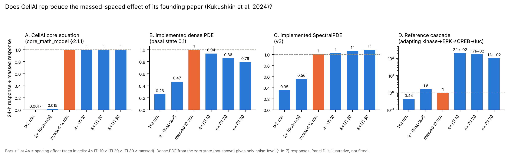
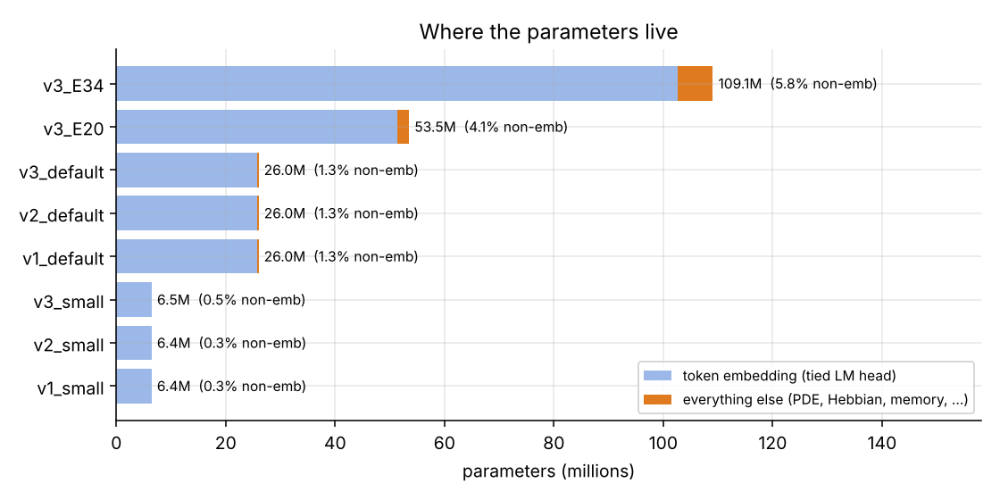
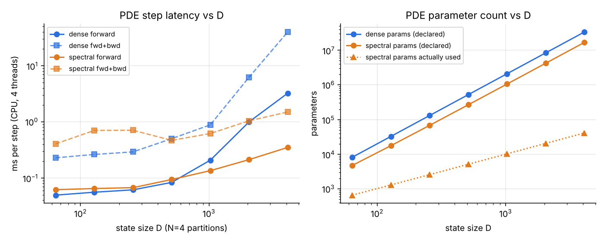
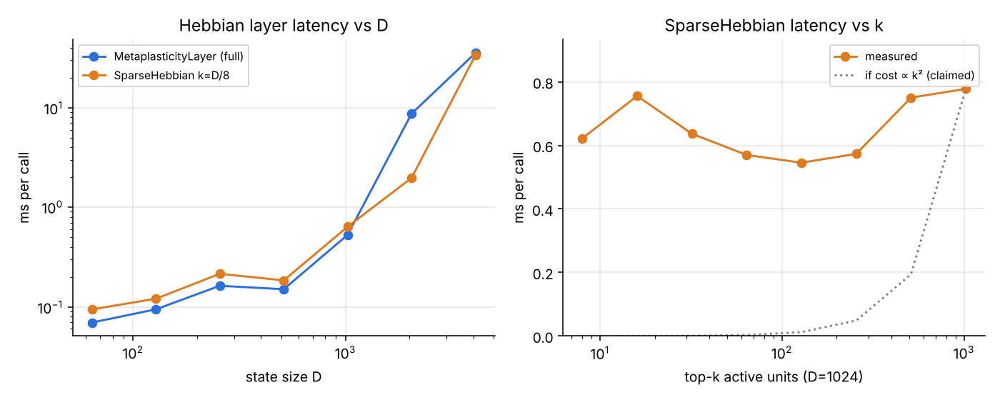
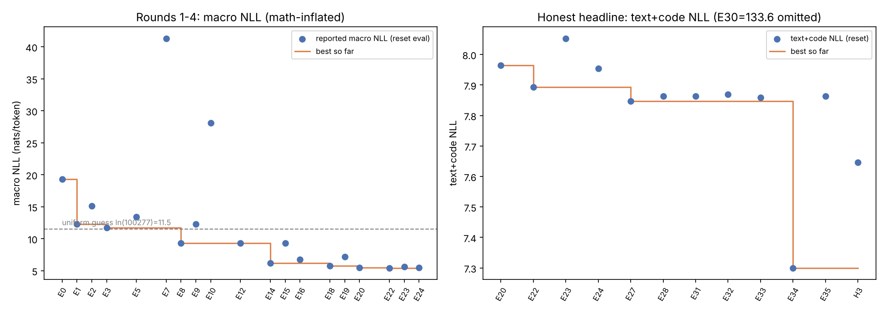
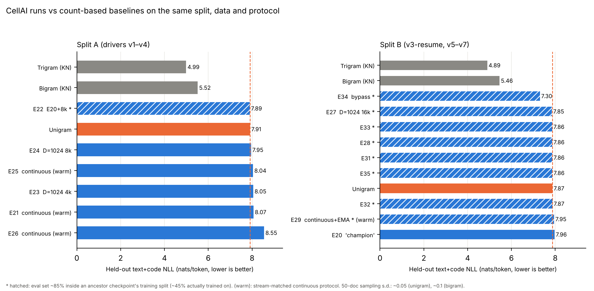
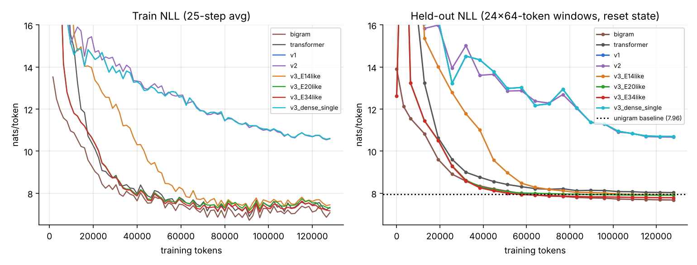

# From Cellular Memory to Language Modelling: An Independent Profile, Biological Assessment and Audit of CellAI

**Subject:** the CellAI repository at commit `a109790` (4 commits, 31 May – 4 Sep 2026), with provenance material from the author's earlier design and research notes.
**Supplementary archive:** `CellAI-audit.zip`, published with this paper ("the archive"). Paths beginning `repository/`, `provenance/` or `paper/` refer to it. Other file paths are relative to `repository/CellAI/` (the audited code, with full git history in `repository/CellAI.bundle`).
**Version:** 1.0 (3 November 2026).
**Artefacts:** every figure, number and script referenced here is in `docs/audit/` (`figures/`, `data/`, `scripts/`) inside the archive.
**Authorship and AI assistance:** see the statement at the end of the paper.

---

## Abstract

CellAI is a research codebase that tries to build a language model from the biology of non-neural cellular memory, as an alternative to attention. We trace its origin to Kukushkin et al. (2024, *Nature Communications* 15:9635), which showed that human kidney and neuroblastoma cell lines display the **massed-spaced learning effect**: four spaced 3-minute pulses of forskolin/TPA induce stronger and longer-lasting CREB-dependent transcription than one 12-minute "massed" pulse, and the effect depends on ERK and CREB. CellAI's first mathematical model encodes that experiment directly: forskolin and TPA doses, 3–12-minute pulses, 10–30-minute intervals, ERK/CREB state variables and a luciferase output. It then abstracts these into a generic reaction–diffusion ODE with Hebbian/BCM-style plasticity. Three generations of models (v1–v3) and a 36-experiment architecture search (E0–E35) follow.

We studied the full system in three ways:

- **Profiling:** runtime measurements on CPU.
- **Mining:** static analysis of 12k lines of code and 12.6k lines of documentation, a table of every experiment, and the raw Round 1–4 result files recovered from the author's earlier notes (included in the supplementary archive).
- **Testing:** count-based baselines under the project's exact data, split and evaluation protocol, and the founding paper's protocols run against CellAI's own dynamics.

**Findings on biology.**

- **The founding phenomenon is lost.** CellAI's core equation is provably blind to stimulus spacing: its response depends only on total exposure, so spaced and massed training give identical memories (ratio 1.000). The implemented PDEs show no spacing effect either: spaced/massed is 0.60–0.96 for the dense PDE (massed wins), and 1.07–1.31 for the spectral PDE, *rising* with longer intervals (the opposite of the cells' ordering). A minimal adapting-kinase → ERK → CREB cascade with positive feedback does reproduce the observed ordering (ITI 10 > 20 > 30 min ≫ massed).
- **The "BCM" rule is not BCM.** It can only potentiate. In v1/v2 it drives the Hebbian matrix to the all-ones matrix (rank 1 after about 4k tokens; every entry at the +1 clamp by 20k), which maps every input to the same direction.
- **Other components have no biological content.** The dense PDE is exactly input-blind at its zero initial state; with its default noise, the input-driven part of the state is about 2% of the noise-driven part. The v2 "resonance", "crystal lattice" and "Kuramoto" terms reduce to a learned but input-independent scalar gain, a rank-27 linear map, and an input-independent bias.

**Findings on language modelling.**

- **Champions score at unigram level.** On the project's own headline metric (held-out text+code NLL), the reported champions score 7.85–8.04 nats/token on average. A smoothed **unigram** model scores **7.87–7.91** on the same documents (the champions are slightly better on text and worse on code); Kneser–Ney bigram and trigram models score **5.46–5.52** and **4.89–4.99**.
- **The best run bypasses the cell.** The best run, E34 (7.30), gains from a zero-initialised path that adds a learned projection of the current token's embedding to the output state: a bigram path around the cellular core.
- **Every Wave 2–4 result is contaminated.** About 85% of the eval documents for E22 and E27–E35 lie in an ancestor checkpoint's training split, and about 45% were actually trained on, because scripts seed their shuffles at import time.
- **Headline figures are wrong.** "966,000×" compares a training loss with a held-out score (the like-for-like ratio is about 2,700×). "125.8 M parameters" is 26.0 M. E20's macro NLL is 5.508 in the raw data, not 5.190.

The project documents its failures unusually candidly, and several of its own diagnoses are confirmed. Its central claims are not supported by the evidence in the repositories: that cellular-memory dynamics learn useful linguistic context, and that the model preserves the biology it was built on. We describe what a faithful and testable version would need.

---

## 1 Introduction

CellAI asks a legitimate and interesting question: can the memory mechanisms of ordinary cells (kinase cascades, transcriptional feedback, plasticity) be turned into a working sequence model? The repository holds three model generations (v1, v2, v3), a shared core library (`cellai_core/`), domain data pipelines, seven generations of architecture-search drivers (`arch_search/run_arch_search*.py`), and two papers:

- [`docs/CELLULARAI_PAPER.md`](../CELLULARAI_PAPER.md): v1/v2 architecture, training, and bug archaeology.
- [`docs/ARCH_SEARCH_PAPER.md`](../ARCH_SEARCH_PAPER.md): the E0–E35 search.

These are supported by [`docs/EVALUATION_REPORT.md`](../EVALUATION_REPORT.md), [`docs/ARCH_SEARCH_FAILURE_LOG.md`](../ARCH_SEARCH_FAILURE_LOG.md), and design documents under `docs/math_models/`, `docs/architecture/` and `docs/research/`.

Neither paper cites the experiment the project is named after. The biology appears in them as Turing patterns, Hebbian/BCM plasticity and Kuramoto oscillators. The actual starting point, a 2024 study of memory in non-neural cell lines, appears only in a research-plan document. This audit therefore does two things.

1. **Biology.** We reconstruct the line from that biology to the code and ask, quantitatively, whether the model keeps the property it was built on.
2. **Machine learning.** We check every empirical claim against code, raw data and appropriate baselines.

**Contributions**

1. **Biological roots and provenance (§2):** the founding experiment, its scientific context, the timeline from paper to code, a component-by-component fidelity assessment, an in-silico replication of the founding protocols on CellAI's dynamics, and the machine-learning lineages the project re-derives without citing.
2. **Profile (§5):** parameters, latency, scaling exponents, op-level profiles and gradient flow for v1, v2, v3 and the true E20/E34 configurations.
3. **Data mining (§6):** a 38-row experiment table, a claims-vs-code audit, verification against recovered raw results, and a bibliography audit of the original papers (89 references).
4. **Baselines (§7):** unigram/bigram/trigram models under the exact records, split and `arch_eval_v1` protocol, plus a parameter-matched training probe.
5. **Mechanism (§8), evaluation integrity (§9), engineering (§10), discussion and recommendations (§11–12).**

---

## 2 Biological roots and provenance

### 2.1 The founding experiment: Kukushkin et al. (2024)

The repository's own description of itself is "an AI based off a Cellular Learning". Its research plan states that it is "inspired by the groundbreaking findings in Kukushkin et al. (2024) demonstrating massed-spaced learning effects in non-neural cells" (`docs/research/computational_research_plan.md:5`). The author also kept a copy of that paper with the project files. It is not redistributed in the archive, because the article's licence (CC BY-NC-ND 4.0) does not permit adapted copies; cite it by DOI.

The study (verified against the full text, PMC11544106):

| Aspect | Kukushkin, Carney, Tabassum & Carew (2024), *Nat. Commun.* 15:9635 |
|---|---|
| Question | Is the spacing effect, a hallmark of memory, a property of neural circuits or of conserved intracellular signalling? |
| Cells | SH-SY5Y (human neuroblastoma) and HEK293 (human embryonic kidney), stably expressing a CRE-driven, PEST-destabilised luciferase (`pGL4.29[luc2P/CRE/Hygro]`, "CRE-luc") |
| "Training" | Forskolin 2 µM (adenylyl cyclase → cAMP → PKA) and/or TPA 2 nM (PKC), in 3-min pulses; 4 pulses at inter-trial interval (ITI) 10, 20 or 30 min; one 12-min "massed" pulse; two-pulse controls |
| "Memory" readout | Luciferase at 2, 4 and 24 h; P-ERK/ERK and P-CREB/CREB (Western); nuclear P-ERK (immunofluorescence) |
| Repetition effect | TPA+forskolin, 4 pulses vs 1: about 1.4× at 4 h (n = 3), 2.8× at 24 h (n = 14). TPA alone: +29% (1×) vs +391% (4×) over control at 24 h. Repetition slows "forgetting" |
| Spacing effect | Spaced > massed at 24 h in every condition. Optimal ITI 10 min (TPA, TPA+forskolin) or 20 min (forskolin), falling with longer ITI. Two pulses are not sufficient |
| Mechanism | Spaced training gives stronger P-ERK, P-CREB and nuclear ERK. MEK inhibitor U0126 (10 µM) and CREB–CBP inhibitor 666-15 (1 µM) abolish the spacing effect. 666-15 also lowers P-ERK, suggesting CREB → ERK positive feedback |
| Generality | Replicated in HEK293, a line with no neural origin |
| Authors' conclusion | "Canonical features of memory do not necessarily depend on neural circuitry, but can be embedded in the dynamics of signalling cascades conserved across different cell types" |

The computational content of this result is specific. A cell is a **temporal pattern detector**: its long-term output depends on how stimulation is distributed in time, not only on how much there is. Repetition changes both the amplitude of the memory and its **rate of decay** (an Ebbinghaus-style forgetting curve).

### 2.2 Scientific context

The study sits in a long line of work. These are the concepts a cellular-memory model has to answer to.

- **The spacing effect.** Distributed practice beats massed practice. This was first documented by Ebbinghaus (1885) and has since been found from humans to invertebrates. In *Aplysia*, spaced training produced long-term habituation (Carew, Pinsker & Kandel, 1972). In *Drosophila*, spaced (not massed) training produces protein-synthesis-dependent long-term memory (Tully et al., 1994), which requires CREB (Yin et al., 1994). Kandel (2001) reviews this "dialogue between genes and synapses".
- **ERK as the timer.** The optimal interval is set by ERK kinetics. In *Drosophila*, the phosphatase SHP2 tunes the spacing optimum through ERK (Pagani et al., 2009). In *Aplysia*, the precise timing of ERK phosphorylation/dephosphorylation decides whether a repeated trial helps or hurts (Kukushkin, Tabassum & Carew, 2022). Smolen, Zhang & Byrne (2016) review the mechanisms. Zhang et al. (2012) used a two-pathway kinase model (PKA and ERK) to design a non-uniform training schedule that enhanced memory, a direct precedent for computational modelling of spacing.
- **Memory in signalling networks.** Biochemical networks can be bistable and store state without neurons: emergent memory in coupled pathways (Bhalla & Iyengar, 1999) and the all-or-none MAPK switch in *Xenopus* oocytes (Ferrell & Machleder, 1998). Persistence of CREB-dependent transcription through positive feedback is one such mechanism, invoked in Kukushkin et al.'s discussion.
- **Cognition in single cells.** Whether single cells *learn* is old and contested: Gelber's *Paramecium* conditioning (Gelber, 1952), reconsidered by Gershman et al. (2021); habituation hierarchies in *Stentor* (Dexter, Prabakaran & Gunawardena, 2019). Lyon et al. (2021) argue for "basal cognition". Kukushkin et al. (2024) is the cleanest modern demonstration of a memory hallmark in non-neural mammalian cells.
- **Synaptic-plasticity vocabulary used by CellAI.** CellAI's design documents use: Hebbian learning (Hebb, 1949); LTP (Bliss & Lømo, 1973); the BCM sliding threshold (Bienenstock, Cooper & Munro, 1982; Intrator & Cooper, 1992; Cooper & Bear, 2012); metaplasticity (Abraham & Bear, 1996; Abraham, 2008); synaptic tagging (Frey & Morris, 1997); synaptic scaling (Turrigiano et al., 1998); and multi-timescale synaptic memory (Fusi, Drew & Abbott, 2005; Benna & Fusi, 2016).
- **Reaction–diffusion and its neural analogue.** Turing (1952) showed that two interacting species with different diffusion rates can form spatial patterns. The neural counterparts are the Wilson–Cowan equations (Wilson & Cowan, 1972, 1973) and Amari's neural fields (Amari, 1977), which produce Turing-type cortical patterns (Ermentrout & Cowan, 1979). These are the appropriate biological references for a "cellular PDE", and neither CellAI paper cites them.

### 2.3 From the experiment to the code: provenance

**Timeline.** Assembled from the papers, the CellAI repository, and the author's earlier notes archived under `provenance/` (sources and commits in `provenance/PROVENANCE.md`).

| Date | Event | Evidence |
|---|---|---|
| 7 Nov 2024 | Kukushkin et al. published (received 21 Feb, accepted 28 Oct 2024) | doi:10.1038/s41467-024-53922-x |
| Nov 2024 – Feb 2025 (inferred) | **Cell AI v1 design documents**: README, "Mathematical Modeling of Cellular Memory Systems for AI Applications" (v2.0), research plans citing Kukushkin as "recently published" | `provenance/original_cell_ai_docs/Cell AI/*`; `docs/math_models/core_math_model.md`, `docs/research/*` |
| 26 Feb 2025 | Cell AI v2 "Thinking", Brain Model and v3/OICFHS design dialogues. Exported claude.ai conversations with **zero lines of executable code**; they presuppose "an already-existing Cell AI" | `provenance/design_history/00-prototypes.md` |
| ≤ 3 Apr 2026 | First implementation trained (v1/v2 on math, NLP, code); evaluation report | `docs/EVALUATION_REPORT.md` (dated 2026-04-03) |
| ≤ 18 Apr 2026 | Architecture search Rounds 1–4 (E0–E26) completed; raw results committed to the author's research-notes repository, untracked a day later | `provenance/raw_results/`; commits of 18 and 19 Apr 2026 in `provenance/PROVENANCE.md` |
| 31 May 2026 | CellAI repository created (single 28k-line commit including both papers) | `eb18003` |
| 5 Jun 2026 | Waves 2–4 (E27–E35) tooling and results | `429615e`, `7be5113` |
| 4 Sep 2026 | AGPL-3.0 + commercial licence | `a109790` |

The author's stated design philosophy, recorded in the v2 design dialogue, matters for what fidelity one should expect:

> "What we are looking for is a model that is bastardised to be computational. It wont be an exact match to that system."
> (`provenance/design_history/Cell AI v2 Thinking Convo Log.txt:1015`)

We take this at face value. The question is not whether CellAI is a faithful biophysical model (it was never meant to be). The question is whether it keeps the **computational property** that motivated it: sensitivity to the temporal structure of input, and history-dependent persistence.

**The translation chain.** Each level of abstraction removes structure. Table 1 tracks each element of the biology through the design model to the code.

*Table 1. From biology to code.*

| Biology (Kukushkin 2024) | Design model (`core_math_model.md`) | Implementation (`cellai_core/`) | What is lost |
|---|---|---|---|
| Forskolin 2 µM / TPA 2 nM pulses, 3 min, ITI 10–30 min, 1–4 pulses | §1.1: "pulse duration 3–12 min, ISI 10–30 min, 1–4 cycles, forskolin 0.1–10 µM, TPA 0.1–10 nM" | One token = one Euler step (dt = 0.01); input = token embedding | Physical time and pulse structure. A token sequence has no notion of interval |
| PKA / PKC activation (two pathways, different sensitivities: PKA to duration, PKC to number of events) | $I_{PKA}$, $I_{PKC}$, composite signals | A single input vector | The two-pathway, two-sensitivity structure Kukushkin identified |
| ERK phosphorylation and nuclear translocation (the "timer") | $ERK_T$, $ERK_P$, $ERK_{N/C}$ state variables | Generic $N \times D$ partition state $S$ | Kinetic species, time constants, compartments |
| CREB phosphorylation, CREB–CBP, transcriptional persistence and feedback | $CREB_T$, $CREB_P$, $CREB_{CBP}$ | No counterpart; nearest is the memory ring buffer (detached) | Positive feedback, bistability, persistence |
| PEST-luciferase (short-lived reporter = readout of current transcription) | $M$: luciferase, phospho-ratios, "memory strength" | Output projection to 100,277-token logits | The readout becomes a vocabulary distribution |
| Signalling dynamics | §2.1.1: $\frac{dS}{dt}=f(I,S,t)-\gamma S+D\nabla^2S+\eta$, with $f_i=\sigma(I-\theta_i)\,g_i(S)$ | `CellularPDE`: $S \leftarrow S+dt\,[\sigma(IW^\top)\odot\tanh(SE^\top)-\gamma S+D\nabla^2_{\text{ring}}S+\eta\epsilon]$ | Multiplicative input gating survives, with $g(0)=0$ (§8.1) |
| (Not in Kukushkin) | §2.3.1 "state-dependent plasticity" $\eta_0 e^{-\lvert S_i-S_j\rvert/\sigma}\,\sigma(I-\theta)$; §2.3.2 metaplasticity $\dot\theta=\alpha(M-\theta)+\beta\int M$ | `MetaplasticityLayer`: $W \mathrel{+}= 0.001\,(\eta' H)(\eta' H)^\top$, clamp ±1 | Adds synaptic-plasticity vocabulary not present in the cellular experiment |

The design model is a reasonable *abstract template* of a signalling cascade. The implementation keeps its algebraic shape but not the properties that produce the spacing effect: two pathways, a slow intermediate integrator with an interval-matched time constant, adaptation, and self-sustaining feedback. Our cross-check of the parameter ranges agrees with an independent reviewer's (Appendix C). The 3/12-minute pulses, 10/20/30-minute intervals and 1–4 repetitions match the paper. The concentration ranges bracket the working doses (2 µM, 2 nM) but are not the paper's tested ranges (0.08–50 µM forskolin, 0.08–200 nM TPA).

**Original claims.** The original Cell AI README (`provenance/original_cell_ai_docs/Cell AI/Readme.html`) claims:

- 100–1000× faster than transformers, 50–200× faster than neural networks, and training "2000× faster than transformers in best cases";
- instant one-shot memory formation, with "no need for traditional backpropagation";
- 95–99% accuracy on familiar patterns, and 80–90% when compressed to 1–5 MB.

No benchmark, dataset or measurement supporting these figures exists anywhere in the archived material. The implemented system is trained by backpropagation through time. Its cost per token is dominated by the vocabulary projection, as in any language model of this vocabulary size (§5.2). Its quality on text and code is at unigram level (§7). The author's design-history notes (`provenance/design_history/00-prototypes.md`) independently list similar unmeasured figures from the same era as "claims that do not hold up".

### 2.4 Component-by-component biological fidelity

*Table 2. Each CellAI component's claimed biological basis, the actual biology, and what the code does.*

| Component | Claimed basis | What the biology actually is | What the code does | Verdict |
|---|---|---|---|---|
| Cellular state | ERK/CREB signalling state | Multiple kinase species with distinct activation and inactivation time constants, nuclear translocation, transcriptional feedback | Generic leaky ODE on a $D$-vector; "time" = token index; $dt = 0.01$ | Kinetic structure not retained |
| Reaction–diffusion "CellularPDE" | Turing (1952) morphogenesis | Two or more interacting species with *different* diffusion rates on a spatial domain (neural analogue: Wilson–Cowan / Amari fields) | One field. The "Laplacian" is `torch.roll(·, dims=0)` across 2–8 *partitions*, not space or features. No second species, so no Turing instability is possible | Name only |
| `MetaplasticityLayer` ("exactly implements BCM", main paper §3.4) | BCM sliding threshold | $\Delta w \propto x\,\phi(y,\theta_M)$ with $\phi$ changing sign at $\theta_M$: depression below, potentiation above. $\theta_M$ is superlinear in mean postsynaptic activity (e.g. $\theta_M = E[y^2]$) | $\Delta W = 0.001(\eta' H)(\eta' H)^\top$ with $\eta'=e^{-\lvert s-m\rvert}\in(0,1]$ and $H=\sigma(x-\theta)\in(0,1)$, so every increment is positive. $\theta$ tracks a "memory" vector linearly | Not BCM: potentiation only, saturates to rank 1 (§8.2) |
| Metaplasticity | Abraham & Bear (1996) | Prior activity shifts the thresholds for later LTP/LTD | $\theta$ shifts a sigmoid's input; it never flips the sign of plasticity | Analogy only |
| Eligibility $e^{-\lvert s-m\rvert}$ | Synaptic tagging (Frey & Morris, 1997) | A protein-synthesis-independent tag that captures plasticity proteins and sets *persistence* (early → late LTP) | Scalar similarity weight on the outer product | Analogy only |
| Online plasticity at inference | LTP during behaviour | Plasticity is continuous | v1/v2: always on (potentiation only). **v3 SparseHebbian: off in `eval()`** (`sparse_hebbian.py:132`); every v3 champion is evaluated with frozen W | Absent from the v3 results |
| SparseHebbian top-$k$ | Sparse cortical connectivity (Braitenberg & Schüz, 1998); NMDA coincidence; "Sanger's rule" | Sparse activity / k-winners-take-all exists in biology (e.g. the fly olfactory circuit: Dasgupta, Stevens & Navlakha, 2017). Sanger's GHA needs a decorrelating subtraction to extract principal components | Top-$k$ mask of a positive activity vector, then a *dense* $D \times D$ outer product. No decorrelation, no PCA convergence | Plausible k-WTA idea; the Sanger and connectivity citations are misapplied (Appendix C) |
| MultiScale partitions (fast every token, slow every 8) | Minicolumns; multi-timescale memory | Synaptic and cellular memory spans seconds to days through cascades of processes (Fusi et al., 2005; Benna & Fusi, 2016) | Clockwork-RNN-style update schedule; the slow-stream gradient falls to about 1e-7 (§5.4) | Sound ML idea (Koutník et al., 2014 lineage); slow stream nearly disconnected |
| Kuramoto oscillators | Buzsáki & Draguhn (2004); Kuramoto (1984) | Coupled phase oscillators; in ML, phases can *be* the representation (Miyato et al., 2025) | $N$ phases with `.detach()` each step; `natural_freq` gets exactly zero gradient; output added as a bias | Input-independent drift |
| "Resonance" (v2) | Frequency-selective gain | Oscillations bias input selection | $\mathrm{Re}(\mathcal F^{-1}(\mathcal F(s)e^{i\phi})) = \cos\phi \cdot s$ exactly | A scalar gain |
| Crystal lattice (v2) | Lattice field theory | No biological analogue | Learned but input-independent symmetric rank-27 linear map $\Phi^\top \mathrm{diag}(T)\Phi$ | Not biology |
| **Spacing effect and forgetting curve** | **The founding phenomenon** | Spaced > massed; repetition slows decay (Kukushkin 2024) | Not modelled; provably absent from the core equation (§2.5) | **Lost** |

### 2.5 Does CellAI show the massed-spaced effect? An in-silico test

**Analytical result.** Take CellAI's core equation (`core_math_model.md` §2.1.1) in its simplest form: a single state, $g(S)=S$, no diffusion or noise.

$$\frac{dS}{dt} = \big(\sigma(I(t)-\theta) - \gamma\big)\,S \quad\Longrightarrow\quad S(T) = S(0)\,\exp\!\int_0^T \big(\sigma(I(t)-\theta)-\gamma\big)\,dt .$$

The integral depends on the stimulus only through the *total time spent at each input level*. Any two protocols with equal total exposure (four 3-minute pulses vs one 12-minute pulse) therefore give **identical** states at every time after both have ended, whatever the spacing. The decay rate after training is $\sigma(-\theta)-\gamma$, independent of the training history, so repetition cannot change the forgetting rate either. A more general linear time-invariant reading, $S(T)=\int h(T-t)\,\varphi(I(t))\,dt$ with a single exponential kernel, makes later-ending protocols marginally stronger. That predicts response *increasing* with ITI, the opposite of the cells' ITI 10 > 20 > 30.

**Numerical test.** We drove four systems with Kukushkin's protocols, using 0.25-min steps over 24 h and the readout relative to an unstimulated control run with identical noise (`scripts/spacing_effect.py`, Fig. 8):

- **A:** the core equation above;
- **B:** the repository's own `CellularPDE`;
- **C:** the repository's `SpectralPDE`;
- **D:** a minimal reference cascade.

The reference cascade has three stages: an adapting kinase (incoherent feed-forward, $\tau = 3$ min); an ERK-like integrator ($\tau = 12$ min, cooperative output); and a CREB-like stage with positive feedback and a 6-h decay, read out through a 60-min luciferase.

*Table 3. 24-h response divided by the massed-protocol response. B and C are means over 5 random initialisations ± s.d.*

| Protocol | A. Core equation | B. Dense PDE (basal state 0.1) | C. SpectralPDE | D. Reference cascade | Cells (Kukushkin 2024) |
|---|---|---|---|---|---|
| 1 × 3 min | 0.002 | 0.26 ± 0.00 | 0.41 ± 0.33 | 0.44 | Weaker than 4×; decays by 24 h |
| 2 × (first + last) | 0.015 | 0.47 | 0.56 | 1.6 | Insufficient (no sustained expression) |
| Massed 12 min | 1 | 1 | 1 | 1 | 1 |
| 4 × ITI 10 | **1.000** | 0.96 ± 0.03 | 1.23 ± 0.38 | **211** | > massed, optimal (TPA, TPA+fsk) |
| 4 × ITI 20 | **1.000** | 0.90 ± 0.07 | 1.09 ± 0.06 | 174 | > massed |
| 4 × ITI 30 | **1.000** | 0.85 ± 0.11 | 1.15 ± 0.11 | 106 | > massed, smaller than ITI 10 |

From the zero initial state used in training and evaluation, the dense PDE produces only noise-level responses (about $10^{-7}$; §8.1), so panel B uses a basal state of 0.1.



*Fig. 8. Does CellAI reproduce the massed-spaced effect of its founding paper? Panel D is illustrative: parameters were chosen by a small grid search for the qualitative ordering, not fitted to data.*

**Interpretation.**

- **None of CellAI's dynamics show the spacing effect.** The core equation is exactly exposure-only. The dense PDE slightly *favours* massed training. The spectral PDE gives tiny responses with no consistent ITI ordering across seeds.
- **The reference cascade reproduces the qualitative biology.** It shows ITI 10 > 20 > 30 ≫ massed ≈ 1× ≈ 2× at 24 h, and repetition changes the forgetting curve: the single pulse decays from 0.036 at 4 h to 0.002 at 24 h, while four spaced pulses grow from 0.25 to 0.81.
- **What it takes.** Three ingredients, each grounded in the biology above, are enough:
  1. **Adaptation**, so repeated onsets beat sustained exposure (receptor or kinase desensitisation; PKC's sensitivity to the *number* of events);
  2. **An intermediate integrator** whose time constant is matched to the inter-trial interval (ERK; cf. Pagani et al., 2009; Kukushkin et al., 2022);
  3. **A cooperative, self-sustaining downstream stage** (CREB with positive feedback; bistable MAPK).

CellAI's equations contain none of these in a working form. The design documents name ERK and CREB, but the implemented dynamics are a single leaky stage whose input enters multiplicatively through a sigmoid.

**Robustness.** Table 3 uses unit-scale stimuli. The model's real token embeddings are √D-scaled (about 16× larger). Re-running B and C at that scale (3 seeds) gives the same conclusion. Dense PDE: spaced/massed 0.89 / 0.74 / 0.60 at ITI 10 / 20 / 30, so massed wins. SpectralPDE: 1.07 / 1.20 / 1.31, rising with ITI as a leaky integrator predicts, the opposite of the cells' ordering.

### 2.6 Machine-learning lineages the CellAI papers do not cite

Several of CellAI's ideas have established, working counterparts. Citing them would sharpen what is new.

- **Fast weights and online plasticity during inference.** Hinton & Plaut (1987); Schmidhuber (1992); Ba et al. (2016); "linear transformers are fast-weight programmers" (Schlag, Irie & Schmidhuber, 2021); differentiable plasticity (Miconi, Clune & Stanley, 2018). More recently, test-time training layers (Sun et al., 2024) and Titans (Behrouz, Zhong & Mirrokni, 2024) make "learning during the forward pass" competitive. In all of these the fast-weight update is error-driven or key–value associative, and so it can store *which* input followed *which*. CellAI's positive-only outer product cannot.
- **Fixed or slow dynamical cores.** Reservoir computing (Jaeger & Haas, 2004; Maass, Natschläger & Markram, 2002) and structured state-space models (Gu, Goel & Ré, 2022; Gu & Dao, 2023).
- **Spectral (FFT) mixing.** Circulant projections (Cheng et al., 2015), FNet (Lee-Thorp et al., 2022) and Global Filter Networks (Rao et al., 2021) are direct precedents for SpectralPDE.
- **Sparse activity.** Sparse coding (Olshausen & Field, 1996), k-sparse autoencoders (Makhzani & Frey, 2013), k-WTA networks (Ahmad & Scheinkman, 2019).
- **Multi-timescale recurrence and oscillators.** Clockwork RNN (Koutník et al., 2014), hierarchical multiscale RNNs (Chung, Ahn & Bengio, 2017), Kuramoto-based neurons (Miyato et al., 2025), neural cellular automata (Mordvintsev et al., 2020).

---

## 3 System overview (as implemented)

Every version shares the same skeleton. For each token $x_t$ (cl100k_base, $V = 100{,}277$):

1. Embed: $e_t = \sqrt D\,E[x_t]$ (the code multiplies by √D, `cellai_core/encoder.py:101`; the main paper's "/√D" is wrong), with $E \sim N(0,1)$ and tied to the output.
2. Advance the partition state with a PDE step, then aggregate to $a_t$.
3. Memory: $m_t = \sum_s w(s)\,e_{t-s} + \sum_s K(s)\,a_{t-s}$ over a 100-step ring buffer with *fixed* kernels and detached inputs (`cellai_core/memory.py:60-119`; the main paper's learned $\tanh(W_m[\cdot])$ does not exist). $m_t$ only modulates the Hebbian update and threshold, never the output path.
4. Hebbian layer: $h_t = (W_H e_t)\odot\sigma(Ga_t+b)$, where $W_H$ is changed in place by the outer-product rule.
5. Output state: $o_t = W_o h_t$ (+ v2/v3 extensions, + optional bypass $\sigma(\alpha)Pe_t$).
6. Logits: $o_tE^\top$, trained with cross-entropy and truncated BPTT over 64-token segments.

The cellular aggregate therefore **gates** a linear function of the current token. Table 2 gives what each component computes. The search ran in seven rounds/waves:

- **Rounds 1–3 (E0–E20):** headline metric "macro NLL", the mean of text, code and math NLL.
- **Round 4 (E21–E26):** macro NLL plus a text+code caveat.
- **Waves 2–4 (E27–E35):** "text+code NLL" under protocol `arch_eval_v1`: 50 documents per modality, first 256 tokens, reset state, per-document mean NLL averaged over documents.

The metric changed because math, scored on generator-templated lines, fell to about 0.5 nats and dominated the macro average.

---

## 4 Method

| Activity | How | Where |
|---|---|---|
| Runtime profiling | CPU (4 cores, 15 GB, no GPU), torch 2.15; median-of-N timings with warm-up; `torch.profiler` | `scripts/profiling/`, `data/profiling_results.json` |
| Static mining | LOC/complexity (radon), import graph, constructor defaults, `git log`, pytest + coverage | §6 |
| Experiment table | Every E-number from the papers, configs and scripts; the paper's own verdict, normalised | `data/experiments.csv` |
| Raw-results recovery | `results.json`–`results_v4.json` (E4–E26) recovered from the author's research-notes history and compared with the papers | `provenance/raw_results/`, §6.4 |
| Split re-derivation | Each driver imported in its natural order; `build_dataset` called on uniquely labelled dummy records; permutations compared | `scripts/split_simulation.py` |
| Baselines | Records rebuilt as `scripts/run_full_pipeline.py` writes them (wikitext-103 train lines ≥ 50 chars; code_search_net Python with docstring prefix, 8k-char cap), first 6,000 per domain, the project's split permutations, `arch_eval_v1` scoring; Kneser–Ney smoothing (Kneser & Ney, 1995; Chen & Goodman, 1999) | `scripts/ngram_baselines.py`, `data/ngram_split_*.json` |
| Training probe | v1, v2, v3 variants vs a 2-layer Transformer, a bigram MLP and unigram, all about 6.4 M parameters (D = 64), 128 k tokens of the repository's own docs | `scripts/profiling/train_probe.py` |
| Biological test | Kukushkin protocols on CellAI's dynamics (§2.5) | `scripts/spacing_effect.py`, `data/spacing_effect_results.json` |
| Literature checks | Crossref and arXiv APIs; Kukushkin full text (PMC11544106) | References; Appendix C |

**Limitations.**

- No checkpoints are available; Wave 2–4 result files were never committed. Reported numbers for those waves are compared as published.
- Our data reconstruction uses current HuggingFace parquet exports. Our training-token count (2.19 M text+code) matches the paper's corpus description (2.3 M including math).
- No GPU was available, so champion-scale training was not repeated.

---

## 5 Profile

### 5.1 Parameters: almost everything is the embedding

| Model | D | Total params | Non-embedding | Embedding share |
|---|---|---|---|---|
| v1 default | 256 | 25,999,104 | 328,192 | 98.7% |
| v2 default | 256 | 26,007,075 | 336,163 | 98.7% |
| v3 default (`V3Config()` = v1 architecture) | 256 | 25,999,104 | 328,192 | 98.7% |
| **E20** (spectral + multiscale + sparse Hebbian) | 512 | **53,512,480** | 2,170,656 | 95.9% |
| E24 / E27 (D = 1024) | 1024 | 108,005,688 | — | — |
| E34 (E27 + bypass) | 1024 | 109,054,265 | 6,370,617 | 94.2% |



- **Wrong headline parameter count.** The README and main paper state **125.8 M** ("25.5 M backbone + 100.3 M embedding"). The embedding is 100,277 × 256 = 25.67 M and the cellular backbone is 0.33 M. `EVALUATION_REPORT.md` has the correct figure (25,999,104). The E20, E23 and E24 counts in the search paper match the raw results.
- **Dead parameters.** `SpectralPDE.input_gate` is a $D \times D$ layer created but never used in `step()`. In E20 it accounts for 327,680 of the 333,344 PDE parameters (98.3%).

### 5.2 Latency and where time goes

| Model | Cell step (ms) | + vocab head (ms) | Inference tok/s | Train tok/s (repo method) |
|---|---|---|---|---|
| v1 default | 0.33 | 1.71 | 587 | 24.1 |
| v2 default | 0.72 | 2.26 | 442 | 23.6 |
| **E20** | 1.06 | 5.90 | 170 | 15.7 |
| E34 | 1.20 | 10.65 | 94 | 7.8 |

All figures are CPU, 4 threads, medians; ±20–30% container noise.

- `torch.profiler` on one 32-token E20 training segment: `aten::mm` takes 59% of time and gradient accumulation (`add_`) 17%. **FFT ops take about 0.6%.**
- The hot path is the tied vocabulary head, run once per token inside the Python time loop.
- Because the head does not affect the recurrent state, and Hebbian updates are deferred until after `backward()`, one batched head per segment gives the same loss and gradient. It is **4.8× (v1), 8.5–9.1× (E20, two independent measurements) and 7.3× (E34)** faster. Equivalently, 79–88% of training time is avoidable per-token head overhead.
- The papers' "4.56 ms / 219 calls/s" and "~130k tok/s" time a single cellular step on a pooled encoding of a whole string, not per-token sequence processing.

### 5.3 Do the complexity claims materialise?



| D | Dense fwd (ms) | Spectral fwd (ms) | Dense fwd+bwd (ms) | Spectral fwd+bwd (ms) |
|---|---|---|---|---|
| 256 | 0.061 | 0.067 | 0.29 | 0.71 |
| 512 | 0.083 | 0.094 | 0.50 | 0.47 |
| 1024 | 0.207 | 0.135 | 0.88 | 0.62 |
| 4096 | 3.23 | 0.35 | 39.7 | 1.50 |

- **SpectralPDE.** Fitted log-log slopes (D ≥ 512) are 1.81 for dense and 0.63 for spectral. Spectral is slower in the forward pass up to D = 512, at parity for forward+backward at D = 512, and at most 1.5× faster at D = 1024.
- **SparseHebbian.** Latency is flat in $k$ (slope 0.02). The implementation forms a dense $D \times D$ outer product and is 20–35% *slower* than the full layer at D ≤ 1024. The search paper itself notes the dense outer product (Appendix A.2) and a wall-clock gain of only 7–8% (§7.1).
- **Sequence length.** Cost is linear (slope 0.8–1.0). There is no batching anywhere in training; batch size is 1.



### 5.4 Gradient flow

| Model (D = 64 probe) | PDE grad norm (step 10 → 2000) | output_proj grad norm | Ratio |
|---|---|---|---|
| v1 | W 1.3e-5 → 8.8e-5 | 103 → 127 | ~10⁻⁶–10⁻⁷ |
| E20-like | fast 0.05 → 1.5e-3; slow 2.1e-3 at step 2000 | 34.6 → 1.62 | ~10⁻³ |
| E34-like | fast 0.05 → 5.1e-3; slow 7.9e-4 at step 2000 | 34.6 → 1.24 | ~10⁻³–4·10⁻³ |

- The dense-PDE "gradient starvation" the paper reports is reproduced, and is worse than reported.
- The cross-scale links (`slow_to_fast`, `fast_to_slow`) end at 1.5e-6 to 4.2e-5 across runs (4e-8 in the E14-like run), 3–5 orders of magnitude below the output projection, so the slow stream is only weakly coupled.
- The resonance phase sits at a stationary point at initialisation (∂L/∂φ = −2.3e-6 at φ = 0, since $\frac{d}{d\phi}\cos\phi = 0$). Kuramoto `natural_freq` gets exactly 0. `MemoryFormation` detaches its inputs.

---

## 6 Data mining

### 6.1 Codebase census

| Measure | Value |
|---|---|
| Python | 73 files / 12,115 lines (8,243 source lines), plus `tools/Math Question Generator/Math-Gen.py` (5,248 lines) |
| Model core (`cellai_core` + v1/v2/v3) | 1,333 source lines |
| Drivers (`arch_search` + `scripts`) | 5,634 source lines |
| Markdown | 31 files, 12,612 lines, 74k words (docs : code words ≈ 1.75 : 1) |
| Highest complexity | `run_arch_search_v4.main` (cyclomatic 50, rank F) |
| Duplication | Successive `run_arch_search_vN` share 16–60% of their distinct lines (difflib similarity 9–36%) and import each other, chaining import-time side effects (§9.1) |
| Tests | 53 pass, 22 fail, 1 collection error; **17% line coverage**; 0% on `arch_search` and `routing` |
| Git | 4 commits (two author identities, one person). Everything to E26 lands in a single 28k-line commit |

Every test failure is API drift, none numeric:

- the registry does not know `v3` (20 tests);
- `MemoryCellBase` was removed;
- `get_system_info` was renamed;
- `CellAIv3` no longer subclasses `CellAIv2`.

### 6.2 The experiment ladder

`data/experiments.csv` lists all 38 rows. Using the papers' own verdicts, 12 of 35 experiments succeeded (34%), 14 failed, 6 were neutral and 3 were partial.

| Round/wave | Success rate |
|---|---|
| R1 (E1–E7; E0 is the baseline) | 2/7 |
| R2 (E8–E14) | 3/7 |
| R3 (E15–E20) | 3/6 |
| R4 (E21–E26) | 1/6 |
| W2 (E27–E29) | 2/3 |
| W3 (E30–E32) | 0/3 |
| W4 (E33–E35) | 1/3 |



1. **Macro NLL hides a plateau.** On text+code the trajectory is flat: E20 7.964 → E22 7.893 → E27 7.847, and five later runs (E28, E31–E33, E35) land at 7.859–7.870; only E34's bypass (7.300) moves it.
2. **Three "experiments" are duplicates.** E9 ≡ E1, E12 ≡ E8, and E5 ≡ E0, all identical to full precision in the raw results. This is because the training loop bypassed `cellular_step()`, the paper's own "Bug 1".
3. **E0 (and, judging by macro NLL, E1–E7) score worse than uniform guessing** (ln V = 11.5 nats) on text and code. Initial losses of 253–2,193 nats come from logits $=sE^\top$ with N(0,1) embeddings and √D-scaled inputs.
4. **Width barely helps.** D = 512 → 1024 improves text+code by 0.01–0.05 nats at matched steps (E20 → E24 at 8k; E22 → E27 at 16k).
5. **Routing never learned.** The five reported routing results (E4 0.320, E11 0.333, E17 0.335, E19 0.345 in the raw results, E31 0.247) sit at the 33.3% chance level of a 3-class task.

### 6.3 Claims vs code

| Claim (source) | Finding |
|---|---|
| "125.8 M parameters" (README; main paper §3.5, which contradicts its own §5.7 and conclusion) | **26.0 M** (§5.1) |
| "E20 … macro PPL 246.6, **966,000×** vs E0" (search paper abstract, §14) | 966,000 ≈ 238 M / 246.6, where 238 M = exp(19.29) is E0's **final training loss**. E0's held-out macro NLL is 13.415, giving **~2,716×** |
| E20 macro NLL 5.190 (search paper §13.7, §14) | Raw result: **5.508** (= ln 246.6) |
| Main paper abstract: PPL "10,000–250,000" | Its own §5.6 reports 450 k–1.18 M |
| Main paper §5.4: math_v1 and code_v2 both "313.3 → 29.3" | `EVALUATION_REPORT.md`: math_v1 16.83 → 7.00, code_v2 313.32 → 29.27; the row is copied |
| SpectralPDE "67,600 params, 32× fewer FLOPs" | 65,536 of those parameters are unused; no wall-clock gain below D = 1024 |
| SparseHebbian "k² = 1,024 updates", "O(D log D)" | Dense $D \times D$ outer product; latency independent of $k$ (the dense outer product is disclosed in the search paper's Appendix A.2) |
| "Exactly implements the BCM sliding-threshold rule" (main paper §3.4) | Potentiation-only; not BCM (§2.4, §8.2) |
| "Online Hebbian adaptation at inference" (main paper §3.4, §6.1) | True for v1/v2 (potentiation only). For v3 champions, SparseHebbian is off in `eval()`, as the main paper's Appendix B and the search paper's §17 disclose, so the headline claim does not apply to v3 |
| v1 "snapshot/restore for fairness" | W is changed by *every* forward pass, including `chat()` and `benchmark()` |
| E26 text+code 8.049 (search paper §17.6) | Its per-domain values (8.718, 8.379) average **8.549** |
| E30 failed from a "random bypass init" (failure log) | The committed code zero-initialises the bypass with α₀ = −8; the stated cause cannot be reproduced from this code |
| "OOD eval (E27): 7.847, no OOD gap" | Reshuffles the **same** eval set (`run_arch_search_v7.py:216`), and is equal to E27's score to 3 d.p. |
| Champion of record | README: E20. `eval_protocol_v1.json`: E22/E25. `experiments.yaml`: E27/E29. Search paper §20: E34/E29 |
| "Ring Laplacian" | `torch.roll(dims=0)` diffuses across 2–8 partitions; for N = 2 it reduces to $2(s_{\text{other}}-s_{\text{self}})$ |

### 6.4 Verification against recovered raw results

The raw results for E4–E26 survive in the history of the author's research-notes repository (committed 18 Apr 2026, untracked the next day). They are archived unchanged in `provenance/raw_results/`. E0–E3 had been overwritten by a resume run. We compared them with the papers:

- **Confirmed.** Per-domain NLLs for E5–E26 match the papers' tables, including E20 (text 8.052, code 7.875, math 0.597) and E24 (7.976 / 7.932 / 0.555). E20's `info` records `hebbian_type = "sparse"`, `resonance_type = "none"`, 53,512,480 parameters, and n = 50 eval documents per modality.
- **Corrected.** E20's macro NLL is 5.508, not 5.190.
- **Duplicates.** E5, E9 and E12 are bit-identical to E0, E1 and E8.
- **Hand-entered.** E22's entry has rounded values (text 7.937, code 7.848, macro 5.428, PPL 227.7), only a first/last training-loss pair, and a free-text note. It was entered by hand, not written by the evaluation code.
- **Coincidence, not error.** E21 and E25 have macro NLL 7.229392 and 7.229248 with different per-domain values (8.228/7.905/5.555 vs 8.255/7.830/5.602).
- **Capped values.** Perplexities for E6, E7 and the "cold" continuous evaluations are all exactly exp(30) = 1.07 × 10¹³, a cap in the code, not a measurement.

### 6.5 Bibliography audit of the original papers

All 89 references in the two papers exist (verified via Crossref, arXiv and publisher pages; details in Appendix C).

- **Author errors:** three (Frankle & "Carlin" → Carbin; a non-existent co-author "Adi, Y." on Tallec & Ollivier, 2018; Grangier omitted from Grave et al., 2017).
- **Missing from the reference list:** four in-text citations.
- **Misused sources:** the serious problems are in how sources are used:
  - the "exactly BCM" claim;
  - Sanger's rule credited with top-$k$ PCA;
  - the metaplasticity chronology reversed (BCM 1982 predates Abraham & Bear's 1996 coinage);
  - "Noam et al., 2020" (Shazeer, 2020; SwiGLU, not "SiGLU");
  - "Liu et al., 2020, Transformers without Tears" (Nguyen & Salazar, 2019);
  - weight-agnostic networks described as "growing neural networks";
  - the CTRL repetition penalty (divides logits; θ ≈ 1.2);
  - the lattice called a Tucker decomposition;
  - a uniform FFT phase rotation called a circular shift (it is $\cos\phi\cdot s$).
- **Founding work not cited:** neither paper cites Kukushkin et al. (2024).

---

## 7 Baselines: what the numbers mean

The project never reported a non-neural baseline on its own split. We built one, following the repository's records, split permutations and scoring:

- **Split A** (drivers v1–v4): E21–E26.
- **Split B** (v3-resume and v5–v7): E20 and E27–E35. E20's eval set is identical to split B in content and order.

| Model (fit on the same ~2.2 M train tokens) | Split A text+code | Split B text+code | s.d. over 50-doc samples |
|---|---|---|---|
| Unigram (add-½) | **7.907** | **7.868** | 0.047 |
| Bigram, interpolated Kneser–Ney | 5.522 | 5.458 | 0.10–0.11 |
| Trigram, interpolated Kneser–Ney | 4.991 | 4.895 | 0.13 |

| CellAI run (reported) | Split | text+code | vs unigram | text vs unigram text | code vs unigram code |
|---|---|---|---|---|---|
| E20 | B | 7.964 | **+0.10 (worse)** | −0.05 | +0.24 |
| E22 (E20 + 8k) | A | 7.893 | −0.01 (noise; contaminated) | −0.18 | +0.15 |
| E23 / E24 (D = 1024) | A | 8.053 / 7.954 | +0.15 / +0.05 | −0.01 / −0.14 | +0.30 / +0.23 |
| E25 (continuous, warm) | A | 8.043 | +0.14 | +0.14 | +0.13 |
| E27 (D = 1024, 16k) | B | 7.847 | −0.02 (noise; contaminated) | −0.22 | +0.18 |
| E28, E31, E32, E33, E35 | B | 7.859–7.870 | ±0.01 | — | — |
| **E34 (bypass)** | B | **7.300** | −0.57; **+1.84 vs bigram** | — | — |

Unigram text NLL: 8.114 (A), 8.099 (B). Unigram code NLL: 7.700 (A), 7.638 (B).



**Interpretation.**

- With up to ~109 M parameters and up to 32k training steps, the reset-regime champions predict held-out text+code, on average, about as well as a token-frequency table.
- Per modality, they are slightly better than unigram on text and consistently worse on code, the domain where local context matters most (a bigram model cuts code NLL from 7.6 to 4.9).
- The only run clearly better than unigram has a direct current-token path, and it recovers about a quarter of the gap to a count-based bigram.
- Most Wave 2–4 decisions rest on differences of 0.012–0.023 nats. That is smaller than the unpaired 50-document sampling s.d. (≈0.05 unigram, ≈0.1 bigram). Models are scored on the same documents, so a paired per-document test would be tighter, but none was reported.

### 7.1 Controlled probe

Every model was trained on the same 128 k tokens (the repository's 26 original documentation files) at about 6.4 M parameters (D = 64), with the same optimiser, 64-token windows and reset state:

| Model | Val NLL (nats) |
|---|---|
| Unigram counts | 7.958 |
| **Bigram MLP (no state)** | **7.674** |
| Transformer, 2 layers (under-trained at this budget) | 8.028 |
| v1 / v2 / v3-default | 10.69 / 10.66 / 10.69 |
| v3 E14-like (spectral + multiscale + full Hebbian + per-freq. resonance) | 7.916 |
| **v3 E20-like** (spectral + multiscale + sparse Hebbian) | **7.905** |
| v3 E34-like (+ bypass) | 7.783 |



*The probe discards SparseHebbian updates accumulated on validation windows. Without that step, validation data leaks into W and the E20-like and E34-like runs score 0.03–0.04 nats better (7.872, 7.740). Repeated runs vary by about ±0.03 nats.*

- The v3 recipes are a large improvement over v1/v2, confirming the *direction* of the E0 → E20 ladder.
- **No Cell variant beats a stateless bigram model.** v3 with the default config reproduces v1 bit for bit.
- The transformer result does not show Cell beating transformers. It is under-trained at this budget.

---

## 8 Mechanism: why the state carries little input information

### 8.1 The dense PDE cannot see its input

$dS = \sigma(IW^\top)\odot\tanh(SE^\top) - \gamma S + D\nabla^2 S + \eta\epsilon$.

- **The input only multiplies the state.** The input enters only multiplied by $\tanh(SE^\top)$, which is exactly 0 at $S = 0$, and every sequence starts there. This is the design model's $f_i = \sigma(I-\theta_i)\,g_i(S)$ with $g(0) = 0$. In a cell, basal kinase activity is never zero; in the code it is.
- **Measured.** With noise off, the state stays exactly 0 for any input. With the default noise and real √D-scaled embeddings (v1, 256 tokens), two completely different inputs with the same noise draw give aggregate states differing by **2.3%**. The same input with a different noise draw differs by **144%**. The state is mostly integrated noise (`scripts/checks/e20sens.py`, `mech.py`).
- **Consequence.** This explains the "gradient starvation" the papers report (∂L/∂W ∝ tanh(SEᵀ) ≈ 0), and why it survived the state-gate fix.

### 8.2 The Hebbian matrix collapses to rank 1

Every increment of the v1/v2 rule is a positive outer product. Starting from $W \sim N(0, 0.01^2)$ with random inputs, in evaluation mode (`scripts/checks/hebbian_saturation.py`):

| Tokens | Energy in top singular direction | Entries at +1 clamp |
|---|---|---|
| 1,000 | 99.76% | 0% |
| 4,000 | 99.98% | 0% |
| 20,000 | 100.00% | **100%** ($\lVert W\rVert_F$ = 256 = D) |

After saturation, $W x = (\mathbf 1^\top x)\,\mathbf 1$ for every $x$: all inputs map to the same direction (mean |cos| = 1.000 across 50 random inputs). `EVALUATION_REPORT.md` reports $\lVert W\rVert_F$ = 256.0 for the trained nlp_v1 and code_v2 checkpoints, exactly the fully saturated value. That fits the main paper's finding that every prompt produced the same code tokens ("incinnati-court(track.HashSet …"). The paper attributes this to a "code-domain attractor"; the saturated Hebbian matrix is a more direct explanation. With the model's own √D-scaled token embeddings, the top direction holds 95% of the energy after 2,000 tokens (`mech.py`). v3's SparseHebbian uses the same positive-only increment (training only), so the same upward drift applies, counterbalanced only by gradient updates.

### 8.3 SpectralPDE is a slow, mostly input-independent integrator

$S \leftarrow S + 0.01\,(\sigma(\cdot) - 0.05\,S + \dots)$.

- Each token can move each coordinate by at most 0.01.
- The sigmoid's mean of about 0.5 produces a large common drift (|S| ≈ 19.7 after 256 tokens).
- The decay time constant ($1/(dt\cdot\gamma)$ = 2,000 tokens) is longer than any 256-token evaluation document.
- At initialisation, with real √D-scaled embeddings in the true E20 configuration, two different 256-token inputs give states differing by **2.9%** (aggregate), **2.7%** (fast stream) and **7.4%** (slow stream).

### 8.4 Readout

The prediction is $(W_H e_t)\odot\sigma(Ga_t+b) \to W_o \to$ tied logits. When the gate is nearly content-free, the best achievable is a low-rank bigram map plus the unigram prior in the tied embeddings, and Hebbian saturation degrades even that. E34's bypass adds a clean, trainable path $Pe_t$, which is why it is the only intervention that moves text+code NLL.

---

## 9 Evaluation integrity

### 9.1 Train/eval contamination through import-time seeding

`build_dataset()` shuffles the 18,000 documents with Python's global `random` and takes the last 15% as eval. Drivers v1–v4 and `v3_resume` seed `random` at **import time**; v5–v7 do not seed but inherit v4's seed through their imports. Imported in their natural order:

- `run_arch_search.py` and v2–v4 resolve to one permutation (**split A**);
- `run_arch_search_v3_resume.py`, which trained the real E20, and v5–v7 resolve to another (**split B**).

Combined with checkpoint resumption:

| Run | Trained from | Eval split | Eval docs inside an ancestor's training split | Expected docs actually trained on |
|---|---|---|---|---|
| E20 | scratch, split B | B | 0% | 0% |
| E21, E23–E26 | scratch / E25, split A | A | 0% | 0% |
| **E22** | E20 (split B) | A | **85.3%** | ≈45% |
| **E27** | E24 (split A) | B | **85.3%** | ≈45% |
| **E28** | E22 (A-trained) | B | **85.3%** | ≈45% |
| **E29** | E25 (split A) | B | **85.3%** | ≈38% |
| **E30–E35, H3, "OOD"** | E27 | B | **85.3%** (inherited) | ≈45% |

Ancestors ran 8k one-document steps over a 15,300-document split, so about 52% of the split was visited: 0.853 × 8000/15300 ≈ 45%. E25's 4k × 256-token continuous run covers about 44% of documents. Among the *scored* first-50-per-modality documents, 87–91% sit in the ancestor split. This assumes the committed import order matches the runs; the search paper (§16.4) notes the runner changed after E22 ran.

**Every Wave 2–4 number, including the E34 champion, is scored on an eval set much of which the starting checkpoint was trained on.** Because these models barely beat unigram, the leak probably flatters them only slightly. It still invalidates them as clean held-out evidence.

### 9.2 Other protocol issues

- **Test-set model selection.** E33's early stopping, E34's "in-train peak 6.996" use the eval set at n = 30 (`run_arch_search_v7.py:105-112, 132-139`); Hyperband selects its learning rate with `_eval_quick(eval_set, n=30)` (`run_arch_search_v7.py:167-188`). E34's headline uses the final model.
- **"Best" checkpoint.** It is simply the latest: `harness.py:115` promotes whenever `tag == "best"`, which `training_v7.py:106` passes on every eval. No reported number depends on it.
- **E34's "frozen" phase is not frozen.** `freeze_except` only clears `requires_grad`; the deferred Hebbian update still changes W.
- **Warm continuous evaluation.** The 4,096-token burn-in is built from the eval set itself (`run_arch_search_v4.py:330, 352-356`). About 30% of scored documents fall inside their own burn-in (`scripts/checks/burn.py`).
- **No error bars or seeds.** There is a single seed and no confidence intervals; 0.01–0.02-nat differences are reported as verdicts.
- **Mixed inference semantics.** v1/v2 evaluate with online Hebbian updates; v3 SparseHebbian evaluates with W frozen.

---

## 10 Engineering findings

| Severity | Finding | Location |
|---|---|---|
| High | Per-token vocabulary head inside the time loop; batching per segment gives a 5–9× training speed-up | `train_step_sequential` |
| High | In-place `W.data` Hebbian updates on a tensor saved for backward bypass autograd's version check, so BPTT uses post-update W | `cellai_core/memory.py` |
| High | Train/eval split depends on import order (§9.1) | `arch_search/run_arch_search*.py` |
| High | Positive-only Hebbian rule saturates W to the all-ones matrix (§8.2) | `cellai_core/memory.py:184-187` |
| Medium | `SpectralPDE.input_gate` unused (65k–328k dead parameters) | `cellai_core/spectral_pde.py:107` |
| Medium | `freeze_except` does not stop Hebbian updates | `training_v7.py:132`, `sparse_hebbian.py:174` |
| Medium | `MetaplasticityLayer` mutates weights in `chat()`/`benchmark()`/`eval()` | `cellai_core/memory.py` |
| Medium | Dense PDE draws `randn` noise during evaluation (nondeterministic eval) | `cellai_core/base.py` |
| Low | `padding_idx=0` zero-initialises token 0 (`!`) and blocks its input-side gradient; it still learns through the tied output head (negligible impact) | `cellai_core/encoder.py:99` |
| Low | Registry and tests out of date; `_test_full.py` requires CuPy | `models/registry.py`, `tests/` |

---

## 11 Discussion

**What the project got right.**

- It starts from a genuinely interesting result, memory hallmarks in non-neural cells, and asks whether it can be turned into computation.
- It diagnoses real pathologies and largely names them correctly: dense-PDE starvation, the dead resonance phase, router collapse, Bug 1, cold-start mismatch, and math inflation of the macro metric.
- It keeps a failure log and moved to a better metric partway through.
- SpectralPDE + MultiScale is a real improvement over the v1 design at matched size (10.7 → 7.9 nats in our probe).
- Decoding-time anti-repetition fixed degenerate generation loops.

**What the evidence does not support.**

- That the cellular state contributes useful linguistic context. No evidence in the repository demonstrates it, and no state ablation was run.
- That CellAI preserves the biology it was inspired by: the spacing effect and history-dependent forgetting are absent, and the plasticity rule is not BCM.
- The original speed and accuracy claims, and the O(D log D) and k² efficiency claims as wall-clock benefits.
- "966,000×", "125.8 M", online Hebbian adaptation in the v3 champions, and the Wave 2–4 rankings as held-out evidence.

**Why the search plateaued.** It optimised components sitting behind a gate whose input carries little input-specific information (§8). Changing width, steps, routing, resonance or auxiliary losses did not change how much input information reaches the state; the bypass routed around it.

**A faithful and testable path.** The founding biology says what a cellular memory model should do: be a temporal pattern detector with history-dependent persistence. That gives two clean experiments:

1. **A biology-first test.** Build a cell that passes the Kukushkin protocols (spaced > massed, optimal ITI, more than 2 pulses needed, slower forgetting after repetition), e.g. with the three ingredients of §2.5. Only then plug it into a sequence model.
2. **An ML-first test.**
   - Let input enter additively and at full strength. Replace $dt\cdot\sigma(\cdot)$ with $dt = 0.01$ by, e.g., $S \leftarrow (1-\lambda)S + \lambda\,\phi(W_sS + W_ie_t)$ with λ ~ 0.1–0.5.
   - Read out from the state directly.
   - Replace the positive-only Hebbian rule with an error-driven or key–value fast-weight rule (§2.6).
   - Ablate the state at evaluation.
   - Compare against bigram and GRU baselines with confidence intervals.

---

## 12 Recommendations

**Integrity.**

1. Build the split once, save the document IDs, make every driver load them, and re-evaluate E22 and E27–E35.
2. Report unigram/bigram/trigram (`scripts/ngram_baselines.py`) and GRU baselines with bootstrap 95% CIs and at least 3 seeds.
3. Use a separate validation split for early stopping and Hyperband.
4. Commit result JSONs, eval manifests and logs.

**Corrections to the write-ups.**

5. Parameter count 125.8 M → 26.0 M.
6. 966,000× → ~2,716× (or drop it).
7. E20 macro NLL 5.190 → 5.508.
8. The main-paper abstract's PPL range.
9. The duplicated math_v1/code_v2 row.
10. The "OOD" label and the stale champion fields.
11. The online-Hebbian claim for v3.
12. The BCM, Sanger, Tucker, CTRL, metaplasticity-chronology and circular-shift statements, and the bibliography errors (Appendix C).
13. **Cite Kukushkin et al. (2024)** and state plainly that the implemented model does not reproduce its phenomenon.

**Engineering.**

14. Batch the vocabulary head.
15. Remove `input_gate`.
16. Implement a sparse (index-based) Hebbian update or drop the claim.
17. Stop mutating weights in `eval()`/`chat()`.
18. Make freezing stop Hebbian updates.
19. Fix the registry and tests.

**Science.**

20. Run the state-ablation, input-strength and Kukushkin-protocol experiments (§2.5, §11) before further component search.

---

## 13 Conclusion

CellAI began from a striking observation: ordinary human cells, not just neurons, distinguish spaced from massed stimulation and remember the difference for a day. The project turned that into a sequence model, documented its journey candidly, and searched 36 configurations. Read against the founding biology, the code, the recovered raw results, correct baselines and a clean split, the evidence shows:

- The implemented dynamics have **lost the founding phenomenon**: the core equation is provably exposure-only, and neither PDE shows a spacing effect.
- The cellular state carries little input-specific information (a few percent at initialisation; dominated by noise in the dense PDE), and the v1/v2 Hebbian matrix saturates to rank 1.
- The best models predict held-out text and code, on average, at unigram level (slightly better on text, worse on code); the single meaningful gain comes from bypassing the cell.
- The efficiency claims do not materialise at the sizes used.
- The most recent rankings rest on a contaminated evaluation split.

None of this rules out cellular-memory-inspired computation. It means the hypothesis has not yet been tested. The founding paper supplies a precise, cheap test (§2.5), and the machine-learning literature supplies working recipes for in-forward plasticity (§2.6).

---

## Statements

**Authorship and AI assistance.**

- This audit was produced with Claude Code (Anthropic), an AI coding agent, at the request of the CellAI repository owner.
- The agent ran all profiling, data mining, baseline, simulation and literature-verification work in a sandboxed environment, and wrote the text.
- Independent sub-agents re-checked the bibliography against primary sources and adversarially re-checked the quantitative claims.
- The person who uploads this record is responsible for its content and should list authorship and AI use according to Zenodo's and their institution's policies.

**Data and code availability.** Everything is in the supplementary archive `CellAI-audit.zip`, with SHA-256 checksums (`SHA256SUMS`).

- **Audited code:** the full repository with its history (`repository/`).
- **This study:** scripts, derived data and figures (`repository/CellAI/docs/audit/`).
- **Provenance:** the raw Round 1–4 results, the original design documents and the design history (`provenance/`, sources in `provenance/PROVENANCE.md`).
- **Not included:** the Kukushkin et al. (2024) article (cite by DOI). Third-party data must be obtained separately: WikiText-103 (Merity et al., 2016) and CodeSearchNet (Husain et al., 2019), via HuggingFace parquet exports.

**Competing interests.** None declared by the producing agent. The audited project is the uploader's own work.

**Licence.** Recommended: CC BY 4.0 for this text and figures; the accompanying scripts follow the repository licence. The Kukushkin et al. (2024) article is CC BY-NC-ND 4.0 and is cited, not reproduced.

---

## References

Abraham, W. C. (2008). Metaplasticity: tuning synapses and networks for plasticity. *Nature Reviews Neuroscience*, 9, 387. https://doi.org/10.1038/nrn2356

Abraham, W. C., & Bear, M. F. (1996). Metaplasticity: the plasticity of synaptic plasticity. *Trends in Neurosciences*, 19(4), 126–130. https://doi.org/10.1016/S0166-2236(96)80018-X

Ahmad, S., & Scheinkman, L. (2019). How can we be so dense? The benefits of using highly sparse representations. arXiv:1903.11257.

Amari, S. (1977). Dynamics of pattern formation in lateral-inhibition type neural fields. *Biological Cybernetics*, 27, 77–87. https://doi.org/10.1007/BF00337259

Ba, J., Hinton, G., Mnih, V., Leibo, J. Z., & Ionescu, C. (2016). Using fast weights to attend to the recent past. *NeurIPS 29*. arXiv:1610.06258.

Behrouz, A., Zhong, P., & Mirrokni, V. (2024). Titans: Learning to memorize at test time. arXiv:2501.00663.

Benna, M. K., & Fusi, S. (2016). Computational principles of synaptic memory consolidation. *Nature Neuroscience*, 19, 1697–1706. https://doi.org/10.1038/nn.4401

Bhalla, U. S., & Iyengar, R. (1999). Emergent properties of networks of biological signaling pathways. *Science*, 283, 381–387. https://doi.org/10.1126/science.283.5400.381

Bienenstock, E. L., Cooper, L. N., & Munro, P. W. (1982). Theory for the development of neuron selectivity: orientation specificity and binocular interaction in visual cortex. *Journal of Neuroscience*, 2(1), 32–48. https://doi.org/10.1523/JNEUROSCI.02-01-00032.1982

Bliss, T. V. P., & Lømo, T. (1973). Long-lasting potentiation of synaptic transmission in the dentate area of the anaesthetized rabbit following stimulation of the perforant path. *Journal of Physiology*, 232(2), 331–356. https://doi.org/10.1113/jphysiol.1973.sp010273

Braitenberg, V., & Schüz, A. (1998). *Cortex: Statistics and Geometry of Neuronal Connectivity* (2nd ed.). Springer. https://doi.org/10.1007/978-3-662-03733-1

Buzsáki, G., & Draguhn, A. (2004). Neuronal oscillations in cortical networks. *Science*, 304, 1926–1929. https://doi.org/10.1126/science.1099745

Carew, T. J., Pinsker, H. M., & Kandel, E. R. (1972). Long-term habituation of a defensive withdrawal reflex in *Aplysia*. *Science*, 175, 451–454. https://doi.org/10.1126/science.175.4020.451

Chen, S. F., & Goodman, J. (1999). An empirical study of smoothing techniques for language modeling. *Computer Speech & Language*, 13, 359–394. https://doi.org/10.1006/csla.1999.0128

Cheng, Y., Yu, F. X., Feris, R. S., Kumar, S., Choudhary, A., & Chang, S.-F. (2015). An exploration of parameter redundancy in deep networks with circulant projections. *ICCV*, 2857–2865. https://doi.org/10.1109/ICCV.2015.327

Chung, J., Ahn, S., & Bengio, Y. (2017). Hierarchical multiscale recurrent neural networks. *ICLR*. arXiv:1609.01704.

Cooper, L. N., & Bear, M. F. (2012). The BCM theory of synapse modification at 30: interaction of theory with experiment. *Nature Reviews Neuroscience*, 13, 798–810. https://doi.org/10.1038/nrn3353

Dasgupta, S., Stevens, C. F., & Navlakha, S. (2017). A neural algorithm for a fundamental computing problem. *Science*, 358, 793–796. https://doi.org/10.1126/science.aam9868

Dexter, J. P., Prabakaran, S., & Gunawardena, J. (2019). A complex hierarchy of avoidance behaviors in a single-cell eukaryote. *Current Biology*, 29, 4323–4329.e2. https://doi.org/10.1016/j.cub.2019.10.059

Ebbinghaus, H. (1913). *Memory: A Contribution to Experimental Psychology* (H. A. Ruger & C. E. Bussenius, Trans.; original work 1885). Teachers College, Columbia University. https://doi.org/10.1037/10011-000

Ermentrout, G. B., & Cowan, J. D. (1979). A mathematical theory of visual hallucination patterns. *Biological Cybernetics*, 34, 137–150. https://doi.org/10.1007/BF00336965

Ferrell, J. E., & Machleder, E. M. (1998). The biochemical basis of an all-or-none cell fate switch in *Xenopus* oocytes. *Science*, 280, 895–898. https://doi.org/10.1126/science.280.5365.895

Frey, U., & Morris, R. G. M. (1997). Synaptic tagging and long-term potentiation. *Nature*, 385, 533–536. https://doi.org/10.1038/385533a0

Fusi, S., Drew, P. J., & Abbott, L. F. (2005). Cascade models of synaptically stored memories. *Neuron*, 45, 599–611. https://doi.org/10.1016/j.neuron.2005.02.001

Gelber, B. (1952). Investigations of the behavior of *Paramecium aurelia*: I. Modification of behavior after training with reinforcement. *Journal of Comparative and Physiological Psychology*, 45, 58–65. https://doi.org/10.1037/h0063093

Gershman, S. J., Balbi, P. E. M., Gallistel, C. R., & Gunawardena, J. (2021). Reconsidering the evidence for learning in single cells. *eLife*, 10, e61907. https://doi.org/10.7554/eLife.61907

Gu, A., & Dao, T. (2023). Mamba: Linear-time sequence modeling with selective state spaces. arXiv:2312.00752.

Gu, A., Goel, K., & Ré, C. (2022). Efficiently modeling long sequences with structured state spaces. *ICLR*. arXiv:2111.00396.

Hebb, D. O. (1949). *The Organization of Behavior*. Wiley.

Hinton, G. E., & Plaut, D. C. (1987). Using fast weights to deblur old memories. *Proceedings of the 9th Annual Conference of the Cognitive Science Society*, 177–186.

Husain, H., Wu, H.-H., Gazit, T., Allamanis, M., & Brockschmidt, M. (2019). CodeSearchNet challenge: Evaluating the state of semantic code search. arXiv:1909.09436.

Intrator, N., & Cooper, L. N. (1992). Objective function formulation of the BCM theory of visual cortical plasticity. *Neural Networks*, 5, 3–17. https://doi.org/10.1016/S0893-6080(05)80003-6

Jaeger, H., & Haas, H. (2004). Harnessing nonlinearity: predicting chaotic systems and saving energy in wireless communication. *Science*, 304, 78–80. https://doi.org/10.1126/science.1091277

Kandel, E. R. (2001). The molecular biology of memory storage: a dialogue between genes and synapses. *Science*, 294, 1030–1038. https://doi.org/10.1126/science.1067020

Kneser, R., & Ney, H. (1995). Improved backing-off for m-gram language modeling. *ICASSP 1995*, 1, 181–184. https://doi.org/10.1109/ICASSP.1995.479394

Koutník, J., Greff, K., Gomez, F., & Schmidhuber, J. (2014). A clockwork RNN. *ICML*, PMLR 32(2), 1863–1871. arXiv:1402.3511.

Kukushkin, N. V., Carney, R. E., Tabassum, T., & Carew, T. J. (2024). The massed-spaced learning effect in non-neural human cells. *Nature Communications*, 15, 9635. https://doi.org/10.1038/s41467-024-53922-x

Kukushkin, N. V., Tabassum, T., & Carew, T. J. (2022). Precise timing of ERK phosphorylation/dephosphorylation determines the outcome of trial repetition during long-term memory formation. *PNAS*, 119, e2210478119. https://doi.org/10.1073/pnas.2210478119

Kuramoto, Y. (1984). *Chemical Oscillations, Waves, and Turbulence*. Springer. https://doi.org/10.1007/978-3-642-69689-3

Lee-Thorp, J., Ainslie, J., Eckstein, I., & Ontañón, S. (2022). FNet: Mixing tokens with Fourier transforms. *NAACL*, 4296–4313. https://doi.org/10.18653/v1/2022.naacl-main.319

Lyon, P., Keijzer, F., Arendt, D., & Levin, M. (2021). Reframing cognition: getting down to biological basics. *Philosophical Transactions of the Royal Society B*, 376, 20190750. https://doi.org/10.1098/rstb.2019.0750

Maass, W., Natschläger, T., & Markram, H. (2002). Real-time computing without stable states. *Neural Computation*, 14, 2531–2560. https://doi.org/10.1162/089976602760407955

Makhzani, A., & Frey, B. (2013). k-Sparse autoencoders. arXiv:1312.5663.

Malenka, R. C., & Bear, M. F. (2004). LTP and LTD: an embarrassment of riches. *Neuron*, 44, 5–21. https://doi.org/10.1016/j.neuron.2004.09.012

Merity, S., Xiong, C., Bradbury, J., & Socher, R. (2016). Pointer sentinel mixture models. arXiv:1609.07843.

Miconi, T., Clune, J., & Stanley, K. O. (2018). Differentiable plasticity: training plastic neural networks with backpropagation. *ICML*, PMLR 80. arXiv:1804.02464.

Miyato, T., Löwe, S., Geiger, A., & Welling, M. (2025). Artificial Kuramoto oscillatory neurons. *ICLR*. arXiv:2410.13821.

Mordvintsev, A., Randazzo, E., Niklasson, E., & Levin, M. (2020). Growing neural cellular automata. *Distill*, 5(2), e23. https://doi.org/10.23915/distill.00023

Olshausen, B. A., & Field, D. J. (1996). Emergence of simple-cell receptive field properties by learning a sparse code for natural images. *Nature*, 381, 607–609. https://doi.org/10.1038/381607a0

Pagani, M. R., Oishi, K., Gelb, B. D., & Zhong, Y. (2009). The phosphatase SHP2 regulates the spacing effect for long-term memory induction. *Cell*, 139, 186–198. https://doi.org/10.1016/j.cell.2009.08.033

Rao, Y., Zhao, W., Zhu, Z., Lu, J., & Zhou, J. (2021). Global filter networks for image classification. *NeurIPS 34*. arXiv:2107.00645.

Sanger, T. D. (1989). Optimal unsupervised learning in a single-layer linear feedforward neural network. *Neural Networks*, 2, 459–473. https://doi.org/10.1016/0893-6080(89)90044-0

Schlag, I., Irie, K., & Schmidhuber, J. (2021). Linear transformers are secretly fast weight programmers. *ICML*, PMLR 139. arXiv:2102.11174.

Schmidhuber, J. (1992). Learning to control fast-weight memories: an alternative to dynamic recurrent networks. *Neural Computation*, 4, 131–139. https://doi.org/10.1162/neco.1992.4.1.131

Smolen, P., Zhang, Y., & Byrne, J. H. (2016). The right time to learn: mechanisms and optimization of spaced learning. *Nature Reviews Neuroscience*, 17, 77–88. https://doi.org/10.1038/nrn.2015.18

Sun, Y., Li, X., Dalal, K., Xu, J., Vikram, A., et al. (2024). Learning to (learn at test time): RNNs with expressive hidden states. arXiv:2407.04620.

Tully, T., Preat, T., Boynton, S. C., & Del Vecchio, M. (1994). Genetic dissection of consolidated memory in *Drosophila*. *Cell*, 79, 35–47. https://doi.org/10.1016/0092-8674(94)90398-0

Turing, A. M. (1952). The chemical basis of morphogenesis. *Philosophical Transactions of the Royal Society of London B*, 237, 37–72. https://doi.org/10.1098/rstb.1952.0012

Turrigiano, G. G., Leslie, K. R., Desai, N. S., Rutherford, L. C., & Nelson, S. B. (1998). Activity-dependent scaling of quantal amplitude in neocortical neurons. *Nature*, 391, 892–896. https://doi.org/10.1038/36103

Wilson, H. R., & Cowan, J. D. (1972). Excitatory and inhibitory interactions in localized populations of model neurons. *Biophysical Journal*, 12, 1–24. https://doi.org/10.1016/S0006-3495(72)86068-5

Wilson, H. R., & Cowan, J. D. (1973). A mathematical theory of the functional dynamics of cortical and thalamic nervous tissue. *Kybernetik*, 13, 55–80. https://doi.org/10.1007/BF00288786

Yin, J. C. P., Wallach, J. S., Del Vecchio, M., Wilder, E. L., Zhou, H., Quinn, W. G., & Tully, T. (1994). Induction of a dominant negative CREB transgene specifically blocks long-term memory in *Drosophila*. *Cell*, 79, 49–58. https://doi.org/10.1016/0092-8674(94)90399-9

Zhang, Y., Liu, R.-Y., Heberton, G. A., Smolen, P., Baxter, D. A., Cleary, L. J., & Byrne, J. H. (2012). Computational design of enhanced learning protocols. *Nature Neuroscience*, 15, 294–297. https://doi.org/10.1038/nn.2990

**Supplementary archive.** CellAI-audit.zip. The CellAI repository at commit `a109790` plus this audit (`repository/`), source material (`provenance/`) and the paper (`paper/`). Published with this record.

---

## Appendix A: Reproducing this study

Run from `repository/CellAI/` in the archive (or a clone restored from `repository/CellAI.bundle`). The scripts write outputs into the directories shown.

```bash
pip install torch tiktoken pyarrow matplotlib radon pytest pytest-cov
export AUDIT_WORK=$PWD/audit_work AUDIT_OUT=$PWD/audit_out
mkdir -p $AUDIT_WORK/dl $AUDIT_WORK/leak $AUDIT_WORK/baselines $AUDIT_OUT

# 1. Split permutations (uniquely labelled dummy records, written to $AUDIT_WORK/split_dummy_data/)
for v in run_arch_search_v4 run_arch_search_v3_resume run_arch_search_v5; do
  python docs/audit/scripts/split_simulation.py $v > $AUDIT_WORK/leak/n_$v.json; done

# 2. N-gram baselines. Download the HF parquet exports into $AUDIT_WORK/dl/:
#    wt0.parquet  = Salesforce/wikitext, wikitext-103-raw-v1/train/0.parquet
#    csn0.parquet = code-search-net/code_search_net, python/train/0.parquet
python docs/audit/scripts/ngram_baselines.py 0 leak/n_run_arch_search_v4.json   # split A
python docs/audit/scripts/ngram_baselines.py 0 leak/n_run_arch_search_v5.json   # split B
python docs/audit/scripts/checks/burn.py 30                                      # burn-in overlap

# 3. Massed-spaced test (Fig. 8)
python docs/audit/scripts/spacing_effect.py $AUDIT_OUT/spacing.json
python docs/audit/scripts/plot_spacing.py $AUDIT_OUT/spacing.json $AUDIT_OUT/fig8.png

# 4. Mechanistic checks (sections 5.1, 8)
python docs/audit/scripts/checks/params.py
python docs/audit/scripts/checks/mech.py
python docs/audit/scripts/checks/e20sens.py
python docs/audit/scripts/checks/hebbian_saturation.py

# 5. Profiling (one model name per call: v1_default v2_default v3_default v3_E20 v3_E34 v1_small ...)
for m in v1_default v2_default v3_default v3_E20 v3_E34; do
  python docs/audit/scripts/profiling/bench_models.py $m >> $AUDIT_OUT/bench.jsonl; done
python docs/audit/scripts/profiling/prof_train.py v3_E20
python docs/audit/scripts/profiling/sweeps.py
python docs/audit/scripts/profiling/resonance_check.py

# 6. Training probe (2,000 steps each; names: v1 v2 v3_dense_single v3_E14like v3_E20like v3_E34like transformer bigram)
for m in v1 v2 v3_E20like v3_E34like transformer bigram; do
  python docs/audit/scripts/profiling/train_probe.py $m 2000; done
python docs/audit/scripts/profiling/plots.py

# 7. Experiment table and figures 1, 6, 7
python docs/audit/scripts/build_experiments.py $AUDIT_OUT
python docs/audit/scripts/plot_fig1.py $AUDIT_OUT/fig1.png

# 8. Codebase census
radon raw -s . ; radon cc -s -n D . ; python -m pytest tests -q --cov=. 

# 9. PDF
python docs/audit/build/build_pdf.py
```

## Appendix B: Files

**Supplementary archive** (`CellAI-audit.zip`):

| Path | Content |
|---|---|
| `README.md`, `SHA256SUMS` | Archive guide; checksums of every file |
| `paper/` | This paper (PDF and Markdown source) |
| `repository/CellAI/` | The audited repository, including this study's `docs/audit/` |
| `repository/CellAI.bundle` | Full git history (`git clone CellAI.bundle CellAI-git`) |
| `provenance/raw_results/` | Raw architecture-search results, Rounds 1–4 |
| `provenance/original_cell_ai_docs/` | Original Cell AI design documents |
| `provenance/design_history/` | Design-history notes and the v2 design dialogue |
| `provenance/PROVENANCE.md` | Source revision and SHA-256 of each provenance file |

**This study's files** (`repository/CellAI/docs/audit/`):

| File | Content |
|---|---|
| `data/experiments.csv` | 38 rows: id, wave, change, D, steps, params, macro NLL/PPL, text+code NLL, latency, outcome, source, notes |
| `data/profiling_results.json` | Runtime measurements for all models. Its `v3_E20` rows use the E14-like configuration (full Hebbian + per-frequency resonance); the true E20 is in `profiling_E20.json` |
| `data/profiling_E20.json` | E20 benchmark and profiler output |
| `data/train_v3_E20like.json`, `data/train_v3_E34like.json` | E20-like and E34-like training-probe runs |
| `data/ngram_split_A_v1-v4.json`, `data/ngram_split_B_v5-v7.json` | Baseline NLLs per modality, 50-doc and full eval sets, sampling s.d. |
| `data/spacing_effect_results.json` | Massed-spaced simulation outputs |
| `figures/fig1–fig8` | Baselines, training probe, parameters, PDE scaling, Hebbian scaling, best-so-far, outcomes by wave, spacing effect |
| `scripts/` | Split simulation, n-gram baselines, spacing simulation, experiment-table builder, figures, profiling harness |
| `scripts/checks/` | Parameter census, mechanistic checks, E20 sensitivity, Hebbian saturation, burn-in overlap |
| `build/` | PDF build (pandoc → HTML → Chromium) and archive builder (`make_archive.py`) |

## Appendix C: Bibliography and claim audit of the original papers (summary)

**Reference-list errors.**

| Paper | Entry | Error | Correct |
|---|---|---|---|
| Search paper | Frankle & Carlin (2019) | Author name | Frankle, J., & **Carbin**, M. (2019). arXiv:1803.03635 |
| Main paper | Tallec, Adi & Ollivier (2018) | Non-existent co-author | Tallec, C., & Ollivier, Y. (2018). arXiv:1804.11188 |
| Search paper | Grave, Joulin, Cissé, Jégou (2017) | Author omitted | Grave, É., Joulin, A., Cissé, M., **Grangier, D.**, & Jégou, H. PMLR 70:1302–1310 |
| Main paper | Bengio, Ducharme, Vincent, Janvin (2003) | Spelling | **Jauvin**, C. |
| Main paper | Mikolov et al. (2010) | Spurious "2(3)" | Interspeech 2010, 1045–1048 |
| Both | Oja (1982) | Title | "Simplified neuron model as a principal component analyzer" |
| Search paper | — | Cited in text, missing from list | Shazeer (2020) arXiv:2002.05202; Keskar et al. (2019) arXiv:1909.05858; Li et al. (2023) doi:10.18653/v1/2023.acl-long.687; Nguyen & Salazar (2019) arXiv:1910.05895 |

**Misused sources (in-text claims).**

| Claim | Problem |
|---|---|
| Rule "exactly implements BCM" | BCM requires a sign change at $\theta_M$; the implemented rule only potentiates |
| Top-$k$ Hebbian = "Sanger's rule … top-k principal components" | GHA needs a decorrelating term; "top-k units" ≠ "top-k components" |
| Metaplasticity "first described by Abraham & Bear 1996 and formalized in BCM 1982" | Chronology reversed |
| "Growing neural networks [Gaier & Ha, 2019]" | That paper is about weight-agnostic networks |
| "SiGLU [Noam et al., 2020]" | Shazeer (2020) defines SwiGLU |
| "[Liu et al., 2020, Transformers without Tears]" | Nguyen & Salazar (2019), which argues for warm-up-free training |
| CTRL repetition penalty "subtracts" logits, p = 1.3 | CTRL divides logits; θ ≈ 1.2 |
| Lattice "equivalent to a 3-way Tucker decomposition" | It is a rank-≤27 symmetric linear map |
| Uniform FFT phase rotation "equivalent to a circular shift" | It equals $\cos\phi \cdot s$ |
| "~1,000 of ~10,000 neighbours connected [Braitenberg & Schüz]" | Not traceable; the commonly cited figure is ~8,200 synapses per neuron (mouse) |
| "Reaction-diffusion fields [Koch & Segev, 1989]" | A methods book on neuron modelling; Turing (1952) or neural-field theory would fit |
| "Frey & Morris: tag gates subsequent LTP" | The tag governs persistence (early → late LTP) |
| Kukushkin et al. (2024) | Not cited by either paper |

**Kukushkin (2024) vs `core_math_model.md` §1.1.**

| Parameter | Design model | Paper | Match? |
|---|---|---|---|
| Pulse duration | 3–12 min | 3 min (12 min only as the massed control) | Partial |
| Interval | 10–30 min | 10, 20, 30 min | Yes |
| Repetitions | 1–4 | 1, 2, 4 | Yes |
| Concentrations | Forskolin 0.1–10 µM; TPA 0.1–10 nM | Tested 0.08–50 µM and 0.08–200 nM; used 2 µM and 2 nM | Brackets the working doses |
